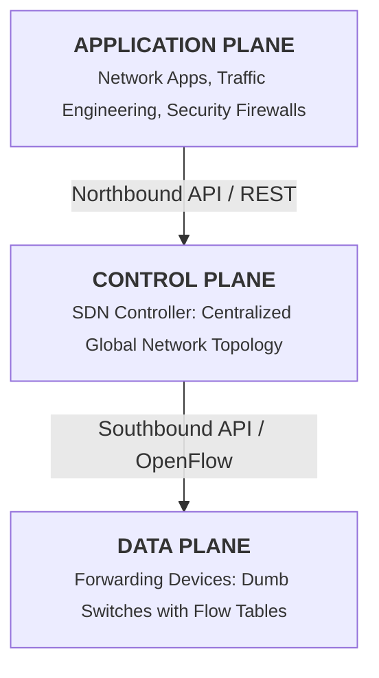

# Chapter 33: Software Defined Networking (SDN) — Part I: Foundations

## Core Concept
Traditional computer networks tightly couple network control logic inside proprietary, distributed hardware switches and routers. Software Defined Networking (SDN) fundamentally restructures this paradigm by decoupling the **Control Plane** (decision-making intelligence) from the **Data Plane** (packet forwarding hardware), creating a centrally managed, programmable network architecture.

---

## 1. Limitations of Traditional Distributed Networking
* **Distributed Routing Protocols:** Protocols like OSPF and BGP run independently on every individual router, calculating shortest paths locally without global visibility.
* **Slow Adaptation:** When a link fails or congestion occurs, distributed convergence is slow and can result in transient routing loops.
* **Vendor Lock-In & Configuration Complexity:** Every router runs proprietary vendor firmware requiring manual CLI configuration on a per-device basis.

---

## 2. The SDN Architecture: Plane Separation

### The Three Planes
1. **Application Plane:** Houses network services (firewalls, load balancers, energy optimizers) that dictate high-level policies.
2. **Control Plane:** The centralized "brain" (the SDN Controller) that maintains a global view of the entire network topology and installs forwarding rules into switches.
3. **Data Plane (Forwarding Plane):** Simple, high-speed packet-forwarding hardware (switches) that inspect incoming packet headers, match them against flow tables, and execute designated actions (forward, drop, or rewrite header).

---

## 3. The Southbound Interface: OpenFlow
* **OpenFlow:** The open standard protocol defining communication between the SDN Controller and Data Plane switches.
* **Flow Table Structure:** Switches store tables of flow rules consisting of:
  * **Match Fields:** Ingress port, Ethernet MAC, IP addresses, TCP/UDP ports.
  * **Counters:** Tracks packet and byte counts for statistics and billing.
  * **Instructions / Actions:** Actions to execute upon match (e.g., Forward to port X, Drop, Send to Controller).

---

## Key Exam Takeaways
* **Core SDN Tenet:** Decoupling the Control Plane from the Data Plane.
* **Control Plane Role:** Centralized decision-making and route orchestration.
* **Data Plane Role:** High-speed hardware packet forwarding based on flow table rules.
* **OpenFlow Standard:** Primary Southbound API between controller and physical switches.
* **Traditional vs. SDN:** Traditional uses distributed per-router intelligence; SDN uses centralized programmable software control.
