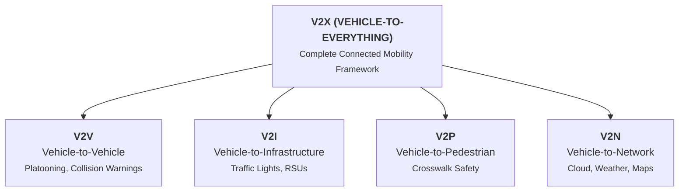

# Chapter 49: Connected Vehicles — Part I: Foundations & V2X

## Core Concept
Connected vehicles transform automobiles from isolated mechanical transport into collaborative cyber-physical nodes. Vehicle-to-Everything (V2X) communication allows vehicles to share telemetry in real time with surrounding cars, roadside infrastructure, and pedestrians to eliminate traffic accidents and optimize traffic flow.

---

## 1. The V2X Communication Taxonomy

* **V2V (Vehicle-to-Vehicle):** Direct peer-to-peer communication between cars (e.g., Emergency Electronic Brake Light warnings).
* **V2I (Vehicle-to-Infrastructure):** Communication with fixed Roadside Units (e.g., traffic signal timing optimization, tolling).
* **V2P (Vehicle-to-Pedestrian):** Collision warning links between vehicles and pedestrian smartphones or wearable beacons.
* **V2N (Vehicle-to-Network):** Cloud connectivity for navigation routing, traffic predictions, and remote software updates.

---

## 2. Vehicular Ad-Hoc Networks (VANETs)
* A specialized class of Mobile Ad-Hoc Networks (MANETs) formed dynamically between moving vehicles.
* **Key Distinctions:**
  * Highly dynamic topology with fast moving nodes.
  * Movement is constrained by physical roads, lanes, and traffic laws.
  * Ample electrical power provided by the vehicle's battery/alternator (unlike energy-starved sensor nodes).

---

## 3. Dedicated Short-Range Communications (DSRC) & WAVE
* **DSRC:** Dedicated wireless communication standard operating in the 5.9 GHz licensed Intelligent Transportation Systems (ITS) band.
* **IEEE 802.11p:** Physical and MAC layer standard adapting Wi-Fi for high-speed vehicular communications.
* **WAVE (Wireless Access in Vehicular Environments):** The full protocol suite (IEEE 1609 family) defining multichannel operation, resource management, and security for DSRC.

---

## Key Exam Takeaways
* **V2X Umbrella:** Encompasses V2V, V2I, V2P, and V2N.
* **DSRC Operating Band:** 5.9 GHz licensed ITS band.
* **Underlying Radio Standard:** IEEE 802.11p.
* **WAVE Standard Family:** IEEE 1609 suite built on top of 802.11p.
* **VANET Power Profile:** Abundant electrical energy supplied by vehicle alternators, eliminating node battery life constraints.
