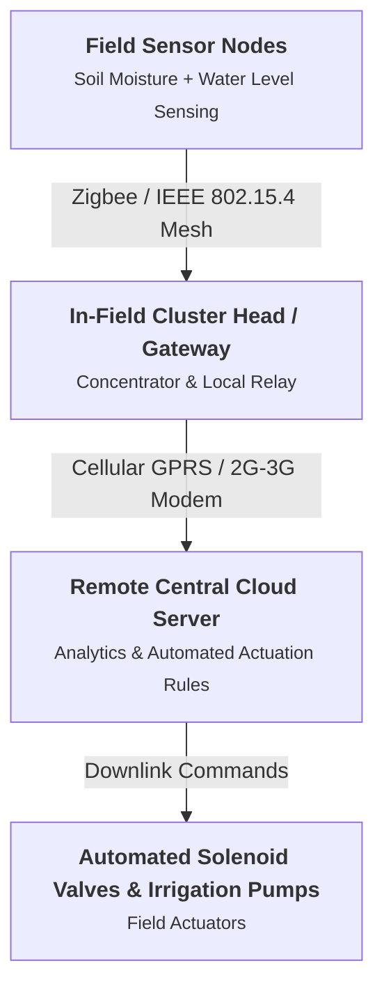

# Chapter 57: IoT Case Study: Precision Agriculture (Agrisens)

## Core Concept
Agriculture is vulnerable to water scarcity, climate unpredictability, and manual labor overhead. The **Agrisens** case study (developed at IIT Kharagpur) demonstrates a real-world, automated precision irrigation management system that uses in-field wireless sensor networks and GPRS cellular backhauls to optimize crop yield and conserve water.

---

## 1. System Architecture of Agrisens
The system follows a two-tier hierarchical sensor network:

---

## 2. In-Field Sensing & Actuation Components
* **Sensor Nodes:**
  * **Soil Moisture Sensors:** Measures volumetric water content in soil strata at root depth.
  * **Water Level Sensors:** Senses standing water depth (critical for crops like paddy/rice that demand controlled inundation).
* **Intra-Cluster Network:** Sensor nodes communicate with the local Cluster Head using low-power **Zigbee (IEEE 802.15.4)** mesh radios to conserve field battery life.
* **Cluster Head (Gateway):** High-capacity field unit powered by a solar panel and battery. Collects local sensor readings and transmits aggregated packets to remote servers over **GPRS cellular** links.
* **Actuators:** Electromechanical **Solenoid Valves** and motorized irrigation water pumps that open or close based on automated threshold logic.

---

## 3. Operational Workflow & Impact
1. Field sensor nodes sample soil moisture and water depth at scheduled intervals.
2. Readings route over Zigbee to the Cluster Head.
3. The Cluster Head transmits data over GPRS to the server.
4. Server rules detect when soil moisture drops below crop-specific wilting thresholds.
5. The server commands the solenoid valve to open and turns on the water pump. Once water depth reaches optimal levels, pumping ceases automatically.
* **Key Benefits:** Prevents over-watering and root rot, lowers agricultural water consumption by 30-50%, and minimizes physical farmer labor.

---

## Key Exam Takeaways
* **Agrisens Case Study Origin:** Developed at IIT Kharagpur for automated precision irrigation.
* **Intra-Field Communication:** Low-power Zigbee (802.15.4) between sensor nodes and cluster heads.
* **Long-Range Backhaul:** GPRS cellular connectivity transmitting data to central servers.
* **Key Sensed Parameters:** Volumetric soil moisture and stagnant water depth (paddy fields).
* **Actuation Mechanism:** Automated solenoid valves controlling water distribution.
