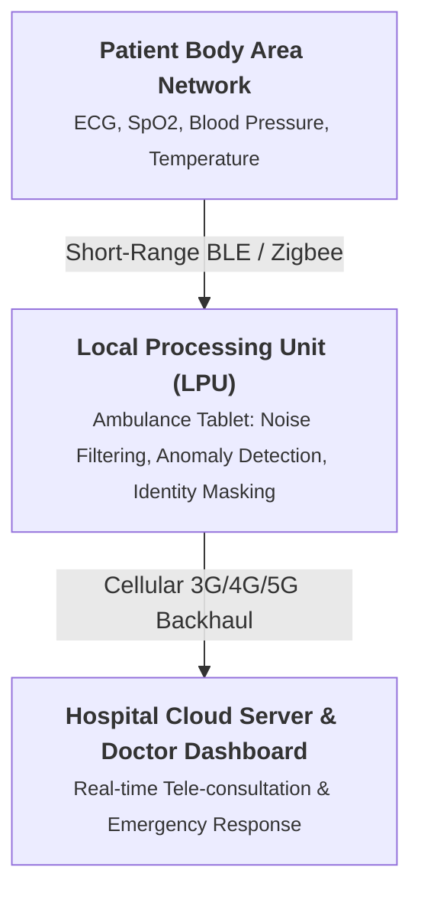

# Chapter 58: IoT Case Study: Healthcare & Telemedicine (Ambisens)

## Core Concept
Continuous physiological vital monitoring improves survival rates during emergency patient transit. The **Ambisens** system (developed at IIT Kharagpur) provides an end-to-end ambulatory healthcare platform that monitors critical biosignals during ambulance transit, transmitting encrypted telemetry to hospital doctors before patient arrival.

---

## 1. The Ambisens Ambulatory Architecture

---

## 2. Core Biosensing & Processing Components
* **Physiological Sensors:** Wearable electrodes and pulse oximeters tracking:
  * **ECG (Electrocardiogram):** Cardiac rhythm and electrical activity.
  * **SpO2:** Peripheral blood oxygen saturation percentage.
  * **Non-Invasive Blood Pressure (NIBP) & Body Temperature**.
* **Local Processing Unit (LPU):** An in-transit mobile smartphone or ruggedized tablet acting as the edge aggregation hub:
  * Performs baseline drift filtering and motion-artifact removal from raw biosignals.
  * Evaluates emergency thresholds locally (e.g., detecting severe ventricular tachycardia).

---

## 3. Medical Privacy: The Identity Masking Module
* **Healthcare Privacy Requirement:** Transmitting identifiable medical records over commercial cellular and public cloud networks violates data protection laws.
* **Identity Masking:** The Ambisens system strips patient names, government IDs, and identifying demographic information at the LPU, replacing them with temporary encrypted session tokens before sending data to the cloud.
* Hospital doctors decrypt the token to view real-time vital streams and prepare emergency trauma teams before the ambulance arrives.

---

## Key Exam Takeaways
* **Ambisens Origin:** Developed at IIT Kharagpur for real-time patient vital monitoring during ambulance transit.
* **Local Processing Unit (LPU):** Edge mobile device performing vital signal filtering and anomaly detection.
* **Identity Masking Module Role:** Anonymizes sensitive patient identity to preserve privacy in cloud storage.
* **Primary Sensed Vitals:** ECG, SpO2 (oxygen saturation), Blood Pressure, and Body Temperature.
* **Core Clinical Benefit:** Enables hospital trauma doctors to begin emergency diagnosis prior to physical arrival.
